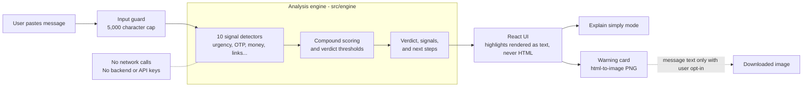

# Scam Shield

> A privacy-first, on-device web application that checks suspicious messages in seconds with zero data leaving your browser.

Scam Shield helps everyday people, older family members, and beginners quickly verify suspicious SMS texts, WhatsApp forwards, courier updates, and job offers. It runs entirely on-device using a pure deterministic TypeScript rule engine, with no logins, no cloud AI calls, and no tracking.

---

## Features

- **100% On-Device & Private**: Evaluates messages locally in milliseconds. Messages never touch a server or database.
- **Deterministic Fraud Detection**: Scans across 10 independent threat categories (urgency pressure, credential harvesting, fake links, remote desktop takeovers, upfront fees, and more).
- **Interactive Highlight Previews**: Displays the message with color-coded and underline-styled highlights explaining why each phrase was flagged.
- **"Explain Simply" Mode**: A dedicated plain-language mode featuring 20px+ text, short sentences, and a 3-step "Do this / Don't do this" layout designed for older family members and non-technical users.
- **Shareable Warning Cards**: Generates high-resolution 1080×1350 PNG warning cards formatted for WhatsApp and family group chats, keeping personal text private by default.
- **Accessible (WCAG 2.2 AA+)**: Full keyboard navigation, screen reader live regions (`aria-live="polite"`), 44px minimum touch targets, and prefers-reduced-motion support.

---

## How Detection Works

Scam Shield uses a deterministic rule-based engine:

1. **Multi-Signal Scanning**: Tests untrusted message text against 10 independent fraud signal detectors (e.g. `sensitive_info`, `remote_access`, `suspicious_links`, `money_request`, `threats`, `urgency`, `too_good_to_be_true`, `unsolicited_kyc`, `impersonation`, `off_platform`).
2. **Compound Risk Combinations**: Identifies dangerous co-occurring indicators (such as fake links paired with urgency, or threats combined with fee demands) to apply compound risk scoring.
3. **Thresholded Verdicts**:
   - **Scam** (Score ≥ 55): High danger zone with confirmed fraud indicators.
   - **Suspicious** (Score 20–54): Cautionary zone with ambiguous patterns requiring vigilance.
   - **Fine** (Score < 20): No overt scam triggers detected.
4. **Tailored Action Checklist**: Automatically generates prioritized, actionable next steps.

---

## Limitations & Honest Safety Note

> **Scam Shield spots warning signs. It can't guarantee a message is safe.**

Scam Shield is designed to detect known scam patterns, manipulative language, deceptive URLs, and credential theft techniques. However, scammers constantly evolve tactics. Legitimate messages should still be treated with care, and sensitive actions should always be verified directly with the organization using their official telephone number or app.

---

## Privacy Model

- **No API Keys**: Scam Shield requires zero API keys or external services.
- **No Network Calls**: Zero `fetch`, XHR, or WebSocket calls are made during analysis.
- **No Analytics / Telemetry**: No tracking cookies, tracking pixels, or third-party scripts.
- **Privacy by Default**: The shareable warning card generator excludes personal message text unless the user explicitly checks the opt-in box.

---

## Running Locally

### Prerequisites
- Node.js 20 or newer
- npm

### Quick Start
```bash
# From the repository root:
npm ci

# Start the local development server
npm run dev

# Run the test suite
npm test

# Build for production
npm run build
```

### Security Checks

The message field and analysis engine both cap input at 5,000 characters. Regression tests verify the Content Security Policy meta tag, ensure application source does not use dangerous HTML injection or fetch/XHR/WebSocket APIs, and confirm that warning cards omit message text unless the user opts in. All analysis runs locally in the browser; no message content is sent to a service.

The npm audit currently reports moderate-severity advisories in development-only dependencies. There are no high- or critical-severity findings. Avoid `npm audit fix --force`: it would introduce breaking major-version upgrades to the test and styling toolchains.

### Continuous Integration

GitHub Actions runs on pushes and pull requests targeting `main`. It installs the lockfile with `npm ci`, then runs the tests and production build.

## Architecture

Everything runs in the browser. There is no application server, database, or external API.



## Project Structure

```text
src/
  engine/       detection engine: signals, scoring, explanations, fixtures, and tests
  components/   Button, Card, Badge, Toggle, Tooltip, WarningCardModal, share-card privacy
  pages/        component gallery (/design)
  styles/       design tokens and global CSS
scope.md        product scope
prd.md          product requirements
spec.md         technical specification
```

## Testing

Run the test suite with:

```bash
npm test
```

The suite has 92 tests covering every signal, 24 fictional scam and legitimate message fixtures, XSS handling, the 5,000-character input cap, Content Security Policy presence, and share-card privacy.

## Disclosures & Acknowledgments

- **Built with the Devpost Learn Skill Pack** as part of the Build With AI learning path.
- **Libraries Used**:
  - [React](https://react.dev/) & [TypeScript](https://www.typescriptlang.org/)
  - [Vite](https://vitejs.dev/) & [Vitest](https://vitest.dev/)
  - [Tailwind CSS](https://tailwindcss.com/)
  - [html-to-image](https://github.com/bubkoo/html-to-image) (client-side card generation)
  - [Lucide React](https://lucide.dev/) (icons)
  - [@fontsource/fraunces](https://fontsource.org/fonts/fraunces) & [@fontsource/inter](https://fontsource.org/fonts/inter)
- **Fictional Brands Only**: All benchmark fixtures and sample presets exclusively reference fictional brands ("Example Bank", "QuickParcel", "FastCourier", "Apex Telecom"). No real company logos or trademarks are used.

---

## License

[MIT License](LICENSE) © 2026 Shikhon Rahaman
